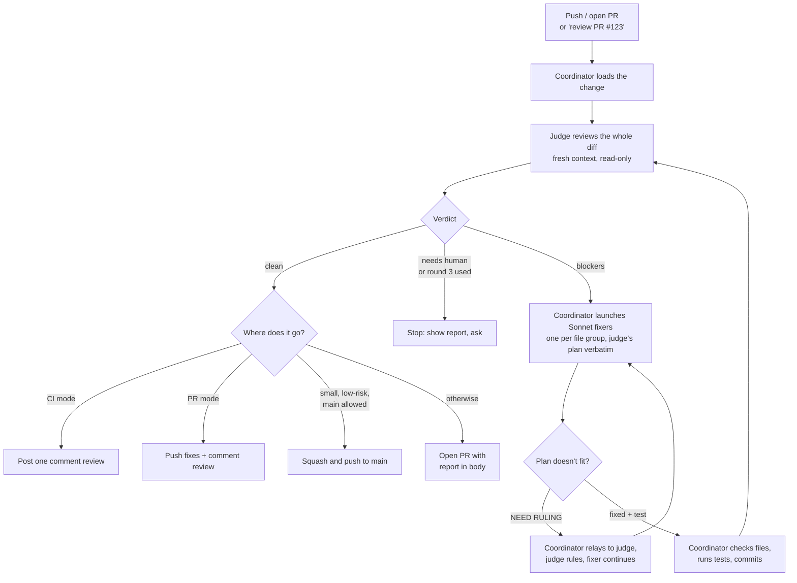

# ship

A ship gate for coding agents. Before every `git push` or `gh pr create`, the change goes through a review → fix → re-review loop that looks for **production blockers only**, at most three rounds. Then it opens a PR, or pushes a small clean change straight to main if your repo allows it. It ends there: `/ship` doesn't deploy or monitor. Those are separate stations.

It skips style and "nice to haves". It hunts for: tenant data leaks, data loss, abuse and cost, wrong production assumptions, N+1 queries, added latency, new dependencies, silent failures, plan gates, duplicated rules, and correctness/i18n regressions.

It also reviews open PRs ("review PR #123") and can run review-only in CI. A PR from a fork is reviewed read-only: its code is never run with your credentials unless you say so.

## Three roles

| Role | Who | Job |
|---|---|---|
| **Coordinator** | your agent session | drives end to end: loads the change, briefs the judge, launches fixers, runs tests, commits, ships, reports |
| **Judge** | a subagent on the strongest model | finds blockers, writes a fix plan for each, rules on fixer questions, confirms fixes next round |
| **Fixers** | Sonnet subagents, one per file group | apply the judge's plan with a regression test |

The judge never sees the conversation that wrote the code, only the diff. So the session that wrote the change never grades its own work. The coordinator can send the judge facts, but can't overrule it.

## How it works



Every round, the same judge reviews the **whole** diff again, not just the fixes. It remembers its earlier blockers and confirms each one, since a fix can open a new blocker elsewhere. CI mode has no fixers: the judge's blockers go out as one comment.

## Install

```bash
mkdir -p .claude/skills
cp -r path/to/ship .claude/skills/
```

Needs [Claude Code](https://claude.com/claude-code) (or any agent that reads `SKILL.md` and runs subagents), `git`, and an authenticated [`gh`](https://cli.github.com/).

## Run it before every push

Add to your `CLAUDE.md` and `AGENTS.md`:

```markdown
# Review before every push

IMPORTANT: Before any `git push` or `gh pr create`, run the pre-push review in `.claude/skills/ship/SKILL.md`. In Claude Code, invoke the `ship` skill; any other agent reads that file and follows it. Skip it only when the user explicitly says to skip it for that push.
```

Straight-to-main is off by default. To allow it, add a line such as `Small clean changes may go straight to main.` to the same file. The skill still sends anything risky (migrations, dependencies, auth, billing, CI, …) through a PR.
