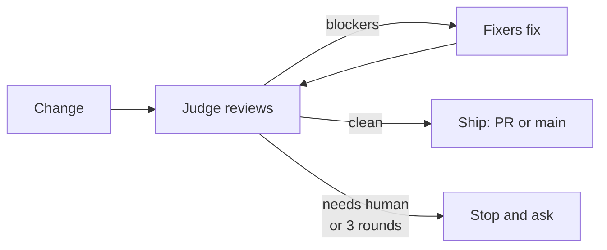

# ship

A pre-push gate for coding agents. Before every `git push` or `gh pr create`, the change goes through a review → fix → re-review loop (max three rounds) that looks for **production blockers only**: tenant data leaks, data loss, abuse and cost, N+1, latency, new dependencies, silent failures. No style nits. It ends at the push, with a PR, or main if your repo allows it. It doesn't deploy or monitor.

It also reviews open PRs ("review PR #123") and runs review-only in CI. Fork PRs are reviewed read-only: their code never runs unless you say so.

## Roles

| Role | Who | Job |
|---|---|---|
| **Coordinator** | your agent session | drives everything: git, briefs, tests, commits, ship, report |
| **Judge** | subagent, strongest model | finds blockers, plans fixes, confirms them next round |
| **Fixers** | Sonnet subagents | apply the judge's plan with a regression test |

The judge sees only the diff, never the conversation that wrote it, so no session grades its own work.



## Install

```bash
mkdir -p .claude/skills && cp -r path/to/ship .claude/skills/
```

Needs [Claude Code](https://claude.com/claude-code) (or any agent that reads `SKILL.md` and runs subagents), `git` and [`gh`](https://cli.github.com/). Then add to your `CLAUDE.md` / `AGENTS.md`:

```markdown
IMPORTANT: Before any `git push` or `gh pr create`, run the `ship` skill (`.claude/skills/ship/SKILL.md`). Skip it only when the user explicitly says so for that push.
```

To allow straight-to-main for small clean changes, add a line like `Small clean changes may go straight to main.` Risky changes (migrations, dependencies, auth, billing, CI) still get a PR.
